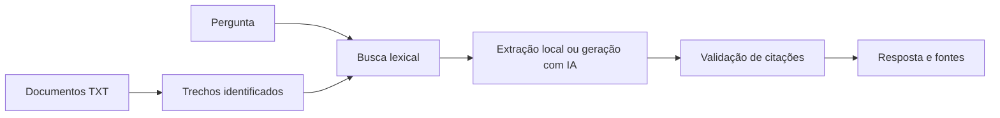

# Lastro

Pesquisa em documentos locais e respostas acompanhadas de trechos verificáveis da fonte.

**Problema:** uma resposta gerada pode parecer convincente sem estar nos documentos. Este projeto recupera trechos antes da geração e exige citações válidas para aceitar uma resposta.

## Fluxo



## Executar sem API

Python 3.11 ou superior. Sem dependências externas.

```powershell
python app.py "Qual o prazo de reembolso?"
python app.py "Qual é o salário?"
```

A primeira consulta recupera o trecho fictício que informa 14 dias. A segunda não encontra correspondência e se abstém. O modo `extractive` retorna um trecho literal; não simula uma resposta de um modelo.

## Executar com IA

Após configurar as variáveis de ambiente:

```powershell
python app.py "Qual o prazo de reembolso?" --provider openai --output outputs/answer.json
```

Somente os trechos recuperados e a pergunta são enviados ao modelo. As citações devem referenciar IDs recuperados e conter trechos literais. Sem evidência ou com citações inválidas, a resposta é rejeitada. Quando a busca não encontra trechos, o sistema se abstém localmente, sem chamar a API.

## Decisões e limites

- A busca é lexical, com normalização de acentos e ponderação por frequência. Não utiliza embeddings, banco vetorial ou busca semântica.
- Trata-se de uma implementação inicial de recuperação seguida de geração. Não equivale a um sistema de RAG validado para produção.
- Sinônimos e perguntas com vocabulário diferente podem não recuperar a fonte correta.
- Citações válidas confirmam a origem do trecho, mas não garantem que toda a resposta esteja semanticamente sustentada. Isso exige avaliação adicional.
- Documentos são divididos em parágrafos e fragmentos de até 1.200 caracteres. A divisão pode separar uma informação que atravesse o limite.
- Entrada limitada a 50 documentos TXT UTF-8 e 2.000 trechos. Não há OCR, autenticação, permissões por usuário ou ingestão de dados privados.
- Os documentos de demonstração contêm políticas inteiramente fictícias.

## O que demonstra

Recuperação de informação, integração de modelo, citações, abstenção, validação e separação entre busca determinística e geração.

## IA real e demonstrações locais

A integração real usa a Responses API da OpenAI e JSON Schema. Configure `OPENAI_API_KEY` e `OPENAI_MODEL` nas variáveis de ambiente, escolhendo um modelo compatível com Structured Outputs. Não há modelo fixo ou chave incluída. Arquivos `.env` não são carregados automaticamente.

Os modos locais não chamam um modelo e não devem ser apresentados como resultados de IA. Os testes usam respostas simuladas de rede. A integração real ainda precisa ser validada com uma chave e um modelo disponíveis na sua conta.

No modo OpenAI, o conteúdo enviado como entrada é transmitido ao serviço. Use os dados fictícios incluídos para começar. A chave fica no ambiente e não entra no código, nos relatórios ou nos logs. A configuração `store=false` é enviada à API; ela não substitui a política de tratamento de dados do provedor.

## Testes

```powershell
python -m unittest discover -s tests -v
```

O fluxo de testes do GitHub Actions usa apenas casos locais e respostas simuladas, sem credenciais de IA. O workflow está preparado, mas a execução no GitHub depende da publicação do repositório.

## Contexto do projeto

Projeto de portfólio de João Carlos Minozzi, desenvolvido com assistência de IA. Os exemplos são fictícios e não representam implantação em clientes ou uso em produção. As decisões e limitações estão documentadas para apoiar estudo, revisão e evolução do código.

Referência de integração: [Structured Outputs](https://developers.openai.com/api/docs/guides/structured-outputs).
